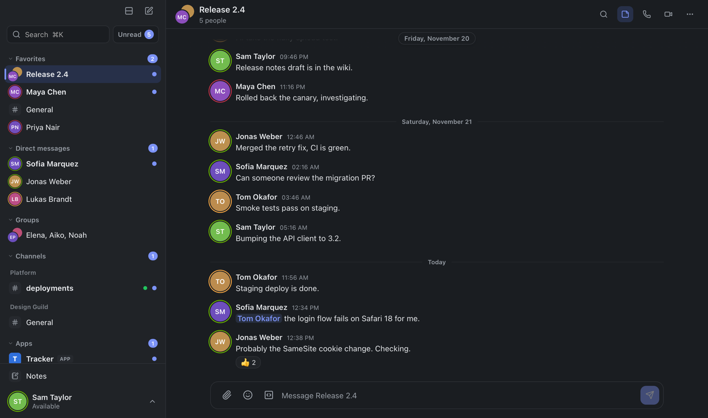
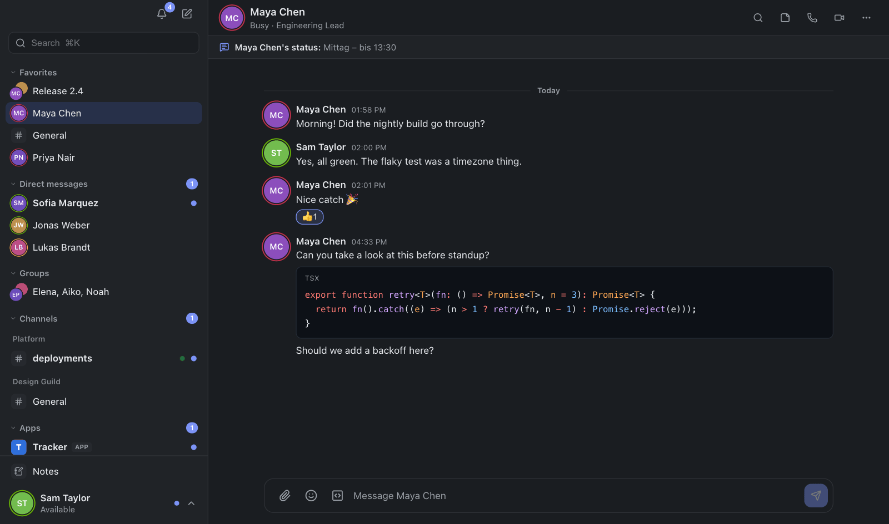
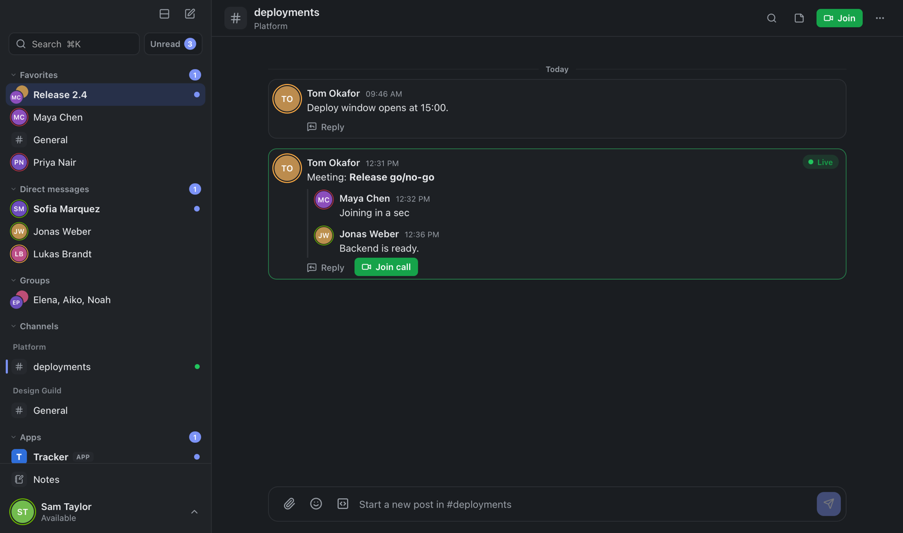
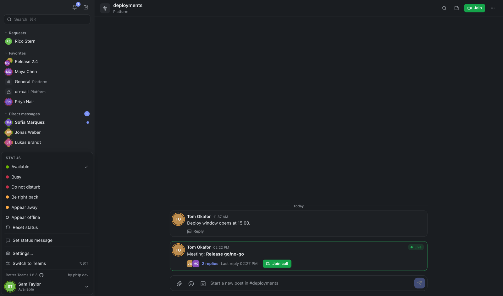

# Better Teams

A calmer, Slack-like client that runs **inside the new Microsoft Teams** desktop
app on macOS. It is a React overlay above Teams: same login, same chats, read
and written through Teams' own backend. Teams keeps running underneath, so
calls, meetings and files still work natively. Toggle with **Option+Cmd+T**.



| Status messages                                                                      | Channels and meetings                                                  | Status menu                                                   |
| ------------------------------------------------------------------------------------ | ---------------------------------------------------------------------- | ------------------------------------------------------------- |
|  |  |  |

Screenshots show the built-in mock data (`pnpm run mock` in `app/`).

> [!WARNING]
> **Use at your own risk.** Better Teams patches the installed Teams app and
> breaks its code signature. It talks to Teams' own backend through internal,
> undocumented APIs, which Microsoft can change at any time. Modifying the
> client is not sanctioned by Microsoft's terms and may break your employer's
> IT policy, so check before using it on a work or managed device. The software
> is provided "as is", without warranty of any kind (see [LICENSE](LICENSE)).
> You alone are responsible for any consequences, including lost messages,
> account or compliance issues, or a broken Teams install.
>
> Better Teams is an independent project. It is not affiliated with, endorsed by
> or supported by Microsoft. "Microsoft Teams" is a trademark of Microsoft.

## Install

Needs macOS, the **new** Microsoft Teams in `/Applications` (tested on 26289.x)
and an administrator password (the Teams app is owned by root). Paste this into
Terminal:

```sh
curl -fsSL https://github.com/ph1p/better-teams/releases/latest/download/install.sh | bash
```

It downloads the latest release into `~/.better-teams`, patches Teams and
relaunches it. Toggle the overlay with **Option+Cmd+T**. Nothing else is
installed and nothing is added to your `PATH`. The installer verifies the
release's SHA-256 checksum before extracting; to verify build provenance
yourself, run
`gh attestation verify better-teams.tar.gz --repo ph1p/better-teams`.

**Update**, or after a **Teams update** removed the patch: run the same line
again.

The overlay follows Teams' language (English or German); the status menu
under your avatar can pin one. Clicking a macOS notification opens that chat
in the overlay too, not only in Teams underneath.

## Uninstall

```sh
~/.better-teams/better-teams uninstall
```

Restores Teams' original bytes (the code signature verifies again), relaunches
Teams if it was running and deletes `~/.better-teams`.

## More commands

```sh
~/.better-teams/better-teams status     # Teams version, patch state
~/.better-teams/better-teams off        # restore original Teams, keep the install
~/.better-teams/better-teams            # patch again and relaunch Teams
~/.better-teams/better-teams doctor     # check requirements
~/.better-teams/better-teams help       # all commands
```

## Troubleshooting

| Symptom                             | Fix                                                                        |
| ----------------------------------- | -------------------------------------------------------------------------- |
| Overlay gone after a Teams update   | Run the install line again.                                                |
| Teams misbehaves or won't start     | `~/.better-teams/better-teams off`, then report the version from `status`. |
| `client-bindings/bundle.js missing` | This Teams build loads differently and is not supported.                   |
| Teams did not quit                  | Quit it from the menu bar, then run the command again.                     |

## Develop

Needs Node.js 22+ and pnpm (`corepack enable pnpm`).

```sh
git clone https://github.com/ph1p/better-teams && cd better-teams
./better-teams dev    # or: cd app && pnpm run dev
```

Relaunches Teams with a DevTools port, runs `vite build --watch` and re-injects
the overlay into every Teams window on each save (~1s, UI state resets).
Ctrl-C relaunches Teams without the port. Run `./better-teams` afterwards to
bake your changes into the patch.

Type-check with `cd app && pnpm run typecheck`.

**Release:** automatic via semantic-release (`.releaserc.json`,
`.github/workflows/release.yml`). Each push to `main` is analyzed with
conventional commits: `fix:` makes a patch release, `feat:` a minor one, and
`BREAKING CHANGE:` a major one. It builds `better-teams.tar.gz`
(`scripts/package-release.sh`), commits the version to `app/package.json`, tags
`vX.Y.Z` and publishes a GitHub release with the tarball, its `.sha256` checksum and
`install.sh`. A release only runs after the full CI workflow passes, and the
tarball gets a build provenance attestation.

### Mock mode (no Teams)

```sh
cd app && pnpm run mock    # http://localhost:5199
```

Runs the overlay in a normal browser on a Vite dev server with hot reload,
backed by fictional people and chats. The Teams-facing modules (`teamsData`,
`send`, `services/{chat,typing,presence}`) are swapped at build time for
stand-ins in `app/src/mock/` that keep state in memory: sending, editing,
reactions, read state and paging work, colleagues "type" and reply, and new
messages trickle in. Calls and meetings only log to the console. Reload to
reset. `src/mock/parity.ts` fails the type-check if a mock drifts from the
real module's exports.

### Layout

```
better-teams                 launcher (start, dev, patch, off, status, uninstall…)
install.sh                 release installer (curl | bash); in a checkout runs the launcher
uninstall.sh               thin wrapper around `better-teams uninstall`
scripts/
  build-host-patch.ts     wraps the app bundle into the bundle.js payload
  dev.ts                  CDP hot-reload for `better-teams dev`
  presence-bridge.ts      presence events in dev mode
app/src/
  mount.tsx                entry: mounts the overlay into a Teams window
  teamsData.ts, data/      read/write layer over Teams' IndexedDB + chat service
  send.ts, services/       sending, typing, presence, auth, CDL, group management
  i18n/                    en/de strings; follows Teams' language
  ui/                      React components
  mock/                    browser-only stand-ins for mock mode
```

## How it works

Teams ships local JS (`Contents/Resources/client-bindings/bundle.js`) that it
runs in a hidden 1×1 host page; every visible window is `window.open`ed from
there. `better-teams` appends the overlay to that file (between
`/*better-teams:begin*/` markers, built by `scripts/build-host-patch.ts`). The
visible windows enforce Trusted Types, so no script can be injected into them;
instead the host page runs the overlay inside `with (childWindow) { … }`, so
`document`, `fetch`, timers etc. resolve to the child window.

## Security & caveats

- **Patching breaks the app's code-signature seal** (`codesign --verify`
  fails). Teams still launches and signs in. `better-teams off` restores the
  exact original bytes and the signature verifies again.
- **Dev mode opens debug port 9222.** While it runs, any local process can
  read and control your signed-in Teams session. Normal use has no port.
- No data leaves your machine except through Teams' own endpoints, with
  Teams' own tokens.
- Microsoft's terms don't sanction modifying the client; this is a personal,
  local-only tweak. On a managed/work device, check your IT policy first.
- macOS only.

## Roadmap

- [ ] **Windows support.** The new Teams there is an MSIX package under
      `C:\Program Files\WindowsApps`, owned by TrustedInstaller, so the macOS
      patch approach does not carry over. Candidates: WebView2 debug-port
      injection or a browser extension for the Teams web app.
- [ ] **Linux support.** There is no native new Teams client; the likely route
      is a browser extension for `teams.microsoft.com`.
- [ ] Cross-platform launcher (Node instead of bash) once the above lands.

## License

[MIT](LICENSE)
